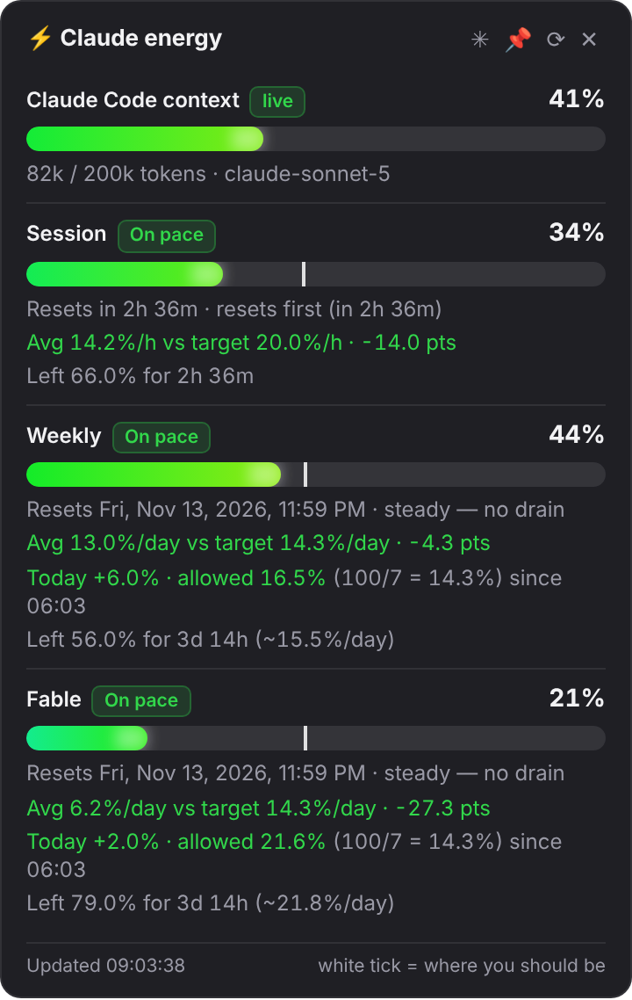

# Claude Usage Meter — Desktop

Your Claude.ai usage limits in the Windows system tray (and the macOS menu bar),
with a daily pace check and a live context meter for Claude Code.

```
Windows   numbered tray badges · hover for pace · click for the energy gauge
macOS     S: 42%  W: 18%  F: 7%   (text in the menu bar)
```



<sub>Screenshot with sample data.</sub>

## Features

### Usage badges
One badge per limit (Session 5h, Weekly, Weekly Opus, Fable) showing the
percentage used. Colour = state: normal, amber from 80%, red from 95%, grey
when the reading is stale. Display → *Taskbar badges* switches to a single badge
for the meter closest to its limit.

### ⚡ Energy gauge (new in 1.1)
**Left-click** any badge for a popup with one bar per meter. Bars fill
green → amber → red and pulse near the limit. The **white tick** is where you
*should* be if usage were spread evenly over the window: bar past the tick =
ahead of pace. **Right-click** opens the menu.

**📌 Pin it** (new in 1.2): click the pin in the gauge title, or menu →
*Keep gauge on screen*. The gauge then stays always on top, doesn't close when
you click elsewhere, can be dragged by its title anywhere, and comes back at the
same spot when the app starts. Click 📌 again or ✕ to unpin.

### 📅 Daily pace (new in 1.1)
A weekly limit allows **100% / 7 days = 14.3% per day**. Hover the Weekly badge:

```
Weekly — 90%, resets ons 4 nov. 00:00
🟢 Avg 13.3%/d · target 14.3
🟢 Today +1.0% (max 11.0)
Left 10.0% · 5h 16m
```

| Line | Meaning |
|---|---|
| **Avg** | average use per day since the week started, vs the 14.3%/day target |
| **Today** | used since midnight, vs the most you can spend today and still last until the reset |
| **Left** | what remains and the time until reset; with more than a day left it adds the %/day you can afford, e.g. `(17.1%/d)` |

🟢 on pace · 🔴 over. The badge itself turns **red** when you are over pace or
over today's allowance (Display → *Red badge when over daily pace*). The 5-hour
Session meter uses the same model per hour (100% / 5h = 20%/h).

"Today" starts at the first reading of the day, so on the day you install it
only counts from that moment.

### 🧠 Claude Code context window (new in 1.1)
A teal badge shows how full the context window of your **active Claude
Code session** is: tokens in context / 200k (1M once a session goes past 200k).
It reads the transcripts Claude Code saves in `~/.claude/projects` every 5 s and
moves after each reply; `/compact` or `/clear` bring it back down. It hides after
30 min without activity; the gauge keeps the last value marked *idle*.

| Works | Doesn't work |
|---|---|
| Claude Code on this PC: terminal, VS Code / JetBrains, desktop app Code tab | claude.ai and Claude Desktop chats (no context size is exposed anywhere) |
| | Claude Code sessions running in the cloud |

Display → *Claude Code context gauge* toggles it; *Context window size* forces
200k or 1M.

## Install

1. Download `Claude Usage Meter Setup x.y.z.exe` from
   [Releases](https://github.com/Cyr79/Claude-Usage-Meter-Desktop/releases).
2. Quit the running meter (right-click a badge → Quit).
3. Run the installer. The build is unsigned, so SmartScreen may warn:
   *More info → Run anyway*. Settings and sign-in are kept.
4. Sign in once when the window opens. It then hides and polls in the background.

Badges hidden? Click the **^** arrow next to the clock and drag them onto the taskbar.

## Run from source

```bash
npm install
npm start
```

## Build

```bash
npm test          # 20 tests: parse, forecast, pace, context
npm run dist:win  # NSIS installer
npm run dist:mac  # DMG (arm64 + x64)
```

On Windows without Developer Mode, electron-builder can fail extracting
`winCodeSign` ("Cannot create symbolic link"). Extract the downloaded `.7z` in
`%LOCALAPPDATA%\electron-builder\Cache\winCodeSign` into a `winCodeSign-2.6.0`
folder once (the two macOS symlink errors are harmless) and rebuild.

### Signing secrets
Optional — unset means unsigned builds with OS warnings.

| Secret | Purpose |
|---|---|
| `MAC_CERT_P12`, `MAC_CERT_PASSWORD` | Developer ID cert, base64-encoded |
| `APPLE_ID`, `APPLE_APP_PASSWORD`, `APPLE_TEAM_ID` | Notarization |
| `WIN_CERT_PFX`, `WIN_CERT_PASSWORD` | Windows code signing |

## Architecture

```
src/main/index.js     tray, menu, polling, energy gauge window, auto-launch
src/main/fetcher.js   direct /api fetch via the persist:claude session (window only for sign-in / fallback)
src/main/parse.js     tolerant tree-walk over the /usage payload
src/main/forecast.js  reset detection + burn-rate regression
src/main/pace.js      daily pace vs 100%/window, today's allowance
src/main/context.js   Claude Code context fill from ~/.claude/projects
src/main/format.js    mac title text / windows icon state + tooltip
src/main/trayicon.js  badge bitmaps drawn by hand (no canvas, no native deps)
src/main/store.js     JSON config in userData
src/renderer/         energy gauge popup (gauge.html + preload)
```

No Playwright: Electron already ships Chromium, so a hidden `BrowserWindow`
with a `persist:claude` partition is the browser, and the fetch runs inside the
page with real cookies, headers and origin.

### Why Windows and macOS differ
macOS lets an app draw text in the menu bar. A Windows tray entry is a 16 px
image plus a tooltip (max 127 characters), so each meter gets its own badge with
the number drawn into it, and the details live in the tooltip and the gauge.

### Details worth knowing
- **pickPct rule.** REST `utilization` is 0..100 (`1` means 1%); SSE
  `message_limit` values are 0..1. `parse.js` never rescales.
- **Reset detection.** `resets_at` creeps forward a few seconds every poll, so a
  reset is only a ≥30 min jump or a drop to ≤40%.
- **User-Agent.** Electron's default UA trips the bot filter (403 on `/api/*`);
  `fetcher.js` strips it.
- **Auth state.** Only a real 401/403 means "signed out"; other failures show an error.

## Known limits
- **Free plans don't work:** `/usage` returns nothing for unmetered accounts.
- **Context meter is Claude Code only** (see above).
- **~150 MB installed** — that's Chromium.

## Changelog
- **1.2.1** — Lighter: usage is read straight from the API (no hidden claude.ai page; window only for sign-in or as fallback), closed gauge is freed.
- **1.2.0** — 📌 Pin the energy gauge: always on top, draggable, remembered position.
- **1.1.1** — "Left 10% · 5h 16m" replaces the confusing %/day figure when less than a day remains.
- **1.1.0** — Energy gauge popup, daily pace vs 100%/7 with red badges, Claude Code context meter.
- **1.0.3** — Weekly reset shown as date and time; larger Windows badges.
